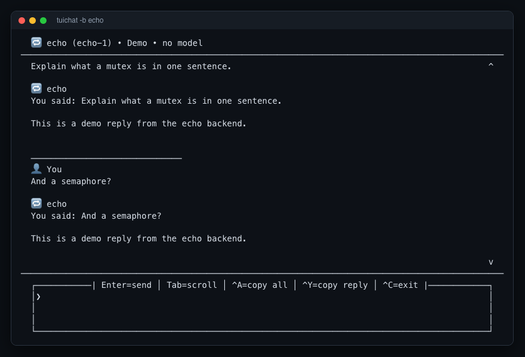

# tuichat

A full-screen terminal chat client for **local models (Ollama)** and **cloud models (OpenAI or any OpenAI-compatible server)**.



*A real session with `tuichat -b echo` (the offline demo backend, no model), captured as text from the terminal, so the colours are not shown. With a real model it looks like this:*

```text
  🦙 ollama (deepseek-r1:14b) • Local • Private
────────────────────────────────────────────────────────────────────────────────
  ──────────────────────────────
  👤 You
  Explain what a mutex is in one sentence.

  🦙 ollama
  A mutex is a lock that lets only one thread use a shared resource at a time.

────────────────────────────────────────────────────────────────────────────────
  ┌─────| Enter=send │ Tab=scroll │ ^A=copy all │ ^Y=copy reply │ ^C=exit |─────┐
  │❯                                                                            │
  └─────────────────────────────────────────────────────────────────────────────┘
```

*(Layout is a real capture from the app; the conversation text is illustrative.)*

## Where this came from

I wrote two near-identical scripts for my own use, `deepseek-cli` (Ollama) and `openai-cli` (OpenAI). About 95% of their code was duplicated. This repository merges them into one tested package with a small backend interface, so adding another model server means writing one class.

It is a thin client, not an AI system: all the intelligence is in the model you connect it to. The value here is the interface and the engineering around it.

## Features

- Streaming replies in a scrollable full-screen layout with mouse support
- **Queue messages while a reply is still streaming**; they are answered in order
- Hides `<think>…</think>` reasoning blocks (for example deepseek-r1) and shows a spinner meanwhile. The filter handles tags split across stream chunks
- `/read file1 file2` loads text files into the conversation (quotes, escaped spaces, `~` and drag-and-drop `@` prefixes all work)
- `/model <name>` switches model without restarting; `/clear` resets the conversation
- Copy the last reply, your last message, or the whole chat to the clipboard (macOS, Linux and Windows tools are detected)
- Basic markup: `**bold**` and `__bold__` render as bold in replies; fenced code blocks get their own style, and Ctrl+K copies the last one
- **Ctrl+C stops a reply** that is still streaming (the part already shown stays in the conversation); when nothing is running it quits
- A **system prompt** from `--system`, `--system-file` or `/system`, sent first on every request without cluttering the conversation (`/clear` keeps it)
- **`/save`, `/load` and `/saves`** keep conversations as small private JSON files in `~/.tuichat/conversations` (or `$TUICHAT_HOME`)
- A **context limit**: once a request passes `--max-context` characters (default 48,000) the oldest messages are left out of what is sent and the chat says so; the full conversation stays on screen and in saved files
- `--timeout` (default 120 s without any data), `--temperature`, and `--num-ctx` for Ollama
- `/models` lists what the server offers; `/help` lists every command and key
- A failed request is shown in the chat and removed from the history, so a retry is not duplicated

## Install and run

```bash
pip install -e ".[ollama]"      # local models; or ".[openai]"; or ".[ollama,openai]"

tuichat                          # Ollama, default model deepseek-r1:14b
tuichat -m llama3.2              # another local model (must be pulled in Ollama)

export OPENAI_API_KEY="..."
tuichat -b openai -m gpt-4o      # OpenAI
tuichat -b openai --base-url http://localhost:1234/v1 -m my-model   # any OpenAI-compatible server

tuichat -b echo                  # offline demo backend: no model, no network

tuichat --system "Answer in one paragraph." --temperature 0.3     # instructions and sampling
tuichat --system-file prompt.txt --num-ctx 8192 --max-context 20000
```

Requires Python 3.10+. For Ollama, run `ollama serve` and `ollama pull <model>` first.

| Key | Action |
|---|---|
| Enter | send |
| Alt+Enter (Esc, Enter) | new line |
| Tab | switch between input and scroll area |
| PageUp / PageDown | scroll |
| Ctrl+Y / Ctrl+U / Ctrl+A | copy last reply / your last message / whole chat |
| Ctrl+C | stop the reply in progress; quit when idle |
| Ctrl+D | quit |
| Ctrl+K | copy the last code block of the last reply |

| Command | Does |
|---|---|
| `/model [NAME]`, `/models` | show or change the model; list the available ones |
| `/system [TEXT\|off]` | show, set or remove the system prompt |
| `/read FILE...` | load text files into the conversation |
| `/save [-f] [NAME]`, `/load NAME`, `/saves` | save (never overwrites without `-f`), load or list conversations |
| `/clear`, `/help` | start over; list commands and keys |

## Design

```
tuichat/
  app.py         the prompt_toolkit application: layout, keys, conversation loop, spinner
  backends.py    Backend interface; Ollama, OpenAI-compatible and Echo implementations
  thinking.py    streaming <think> filter (buffers partial tags across chunks)
  text.py        wrapping, bold and code-block markup, user-line marking (pure functions)
  context.py     leaves the oldest messages out of a request above the size limit
  store.py       /save and /load: validated names, private files, atomic writes
  files.py       /read: path parsing and file loading
  commands.py    slash-command parsing
  clipboard.py   cross-platform clipboard
  cli.py         argument parsing
```

A backend implements one method, `stream(messages)`, an async generator of text chunks, and raises `BackendError` with a message worth showing. The rest of the app does not know which model is behind it.

## Tests

```bash
pip install -e ".[dev]"
pytest -q
```

113 tests, none of which need a model or a network. Backends are tested against fakes of the `ollama` and `openai` clients. The application itself is tested headlessly with a fake terminal, including a full run that types a message, waits for the reply and exits with Ctrl-D.

## Limitations

- The Ollama and OpenAI adapters are tested against fakes of their client libraries. I ran the Ollama path against a real local model by hand; the OpenAI path has not been run against the live API in this repository.
- `<think>` filtering is tag-based. A model that marks reasoning differently is shown as-is.
- The context limit counts **characters**, not tokens (about 4 characters per token for English), and it is a safety net, not a guarantee: the right size depends on the model. Leaving out the oldest messages also drops any files loaded with `/read` early in a long chat.
- Saved conversations are plain JSON on your disk, readable by anyone with access to your account. They are not encrypted.
- Text rendering is still basic: bold and fenced code blocks are interpreted, not headings, lists or tables.
- `--timeout` is the time without **any** data, not a limit on the whole reply. The new options (timeout, temperature, `/models`) are tested against fakes of the client libraries, like the rest; I have not run them against a live OpenAI server.

## AI assistance

The two original scripts were written by me. This merged and refactored version, with its tests, was developed with AI assistance (Claude Code). I specified the design and reviewed the result.

## License

MIT.
